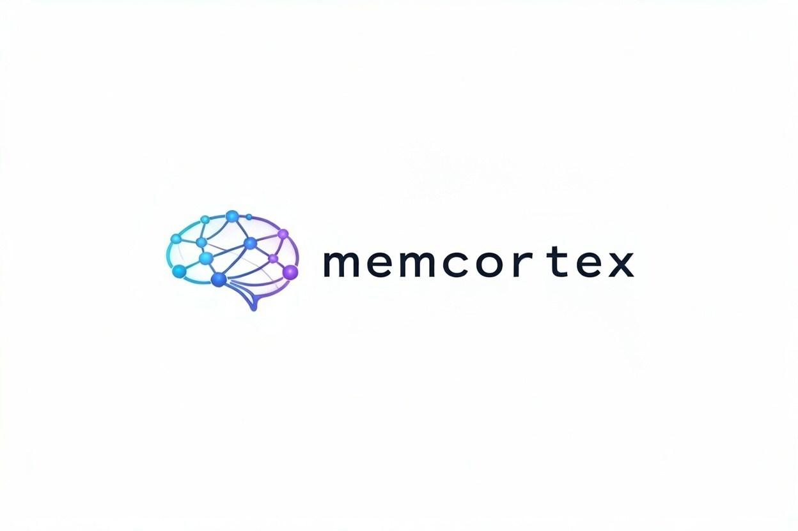
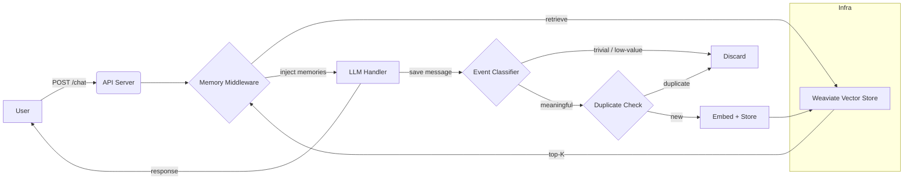

<p align="center">
  
</p>

# Memcortex

**Persistent Memory Layer for LLMs (Memory-RAG)**

Memcortex is a Proof of Concept (PoC) designed to equip conversational agents and LLM applications with persistent, long-term memory. By implementing a Memory-RAG (Retrieval-Augmented Generation) architecture, Memcortex allows agents to transcend context-window limitations, enabling them to recall past interactions and specific data points indefinitely.


<p align="center">
  <a href="https://github.com/sobowalebukola/memcortex/actions/workflows/ci.yml">
    
  </a>
  
  
  
  
  <a href="https://blog.stackademic.com/inside-memcortex-a-lightweight-semantic-memory-layer-for-llms-394cf940191a">
    
  </a>
</p>


---

## Contents

* README (this file)
* Architectural diagram (Mermaid + ASCII)
* Package structure
* How to start

---

## Project Overview

Memcortex stores user/application memories as both text and vectors in Weaviate and exposes a memory manager + middleware that:

1. **Classifies** incoming messages through an event-driven pipeline to determine if they are worth persisting.
2. **Embeds** meaningful text using `nomic-embed-text` embeddings.
3. **Deduplicates** against existing memories using vector similarity before saving.
4. **Stores** memories in a `Memory_idx` class on Weaviate with metadata (event type, weight, TTL).
5. **Retrieves** top-K relevant memories via vector search, scoped per user.
6. **Injects** retrieved memories into the prompt before it reaches the LLM.

This pattern is ideal for building chatbots, agents, and personalization layers that must "remember" details across sessions.


---

## Architecture (Mermaid)



### ASCII Diagram

```
User -> API Server (/chat)
      -> Memory Middleware:
           - Embed user query via Ollama
           - Query Weaviate vector index (top-K)
           - Format and inject into request context
      -> Chat Handler:
           - Return response with related memories
           - Classify message (preference / goal / correction / profile / achievement)
           - If low-value or trivial -> discard
           - If meaningful -> embed via Ollama
           - Check for near-duplicate memories -> skip if found
           - Save to Weaviate with metadata (event_type, weight, ttl_days)
```

---

## Event-Driven Memory

Not every message is worth remembering. Memcortex includes an event classifier that scores each incoming message and only persists meaningful events.

### How it works

1. Each message is scored by a multi-signal heuristic classifier.
2. Positive signals (pattern matches) boost the score. Negative signals (questions, negations, third-person references) apply penalties.
3. If the final weight is below `MIN_EVENT_WEIGHT`, the message is discarded.
4. If the message passes classification, it is embedded and checked against existing memories for near-duplicates.
5. New, unique memories are stored with metadata: `event_type`, `weight`, and `ttl_days`.

### Event types

| Type | Weight | TTL | Examples |
|------|--------|-----|----------|
| `correction` | 0.95 | never | "Actually my role is...", "I meant..." |
| `profile` | 0.90 | never | "My name is...", "I work at...", "Call me..." |
| `preference` | 0.90 | never | "I prefer...", "My favorite...", "I'd rather..." |
| `goal` | 0.85 | 90 days | "I plan to...", "I'm working on...", "Remind me to..." |
| `achievement` | 0.80 | 365 days | "I shipped...", "I got promoted...", "I launched..." |
| `general` | 0.15-0.45 | 30 days | Unmatched messages, scored by word count |
| `trivial` | 0.00 | -- | "ok", "thanks", "lol", short filler |

### Penalties

| Signal | Penalty | Rationale |
|--------|---------|-----------|
| Question (`?`, "what", "how do you"...) | -0.25 | Queries are not facts to remember |
| Negation ("don't", "not", "never"...) | -0.15 | Weakens the signal of the statement |
| Third-person ("he", "she", "they" without "I") | -0.35 | Not about the user |

### Configuration

- `MIN_EVENT_WEIGHT=0.3` -- Threshold for saving. Set to `0` to save everything (disables filtering).
- `DUPLICATE_DISTANCE=0.05` -- Vector distance below which a memory is considered a duplicate. Set to `0` to disable dedup.

---

## Quickstart (developer)

Prereqs:

* Go 1.24+
* Docker & Docker Compose

1. Copy repo and set module path (or `go mod init github.com/yourname/memcortex`).
2. Create `.env` (see `.env.example`).
3. Build docker image & run server:

```bash
docker-compose up -d --build
```


5. Example request:

```bash
curl -X POST http://localhost:8080/chat \
  -H "Content-Type: application/json" \
  -H "X-User-ID: memcortex-user-x" \
  -d '{"message":"My preferred memory layer is memcortex."}'
```
Shown below are example requests using Thunderclient (you can use any api client of choice. Remember to set the `X-User-ID` in the headers)


The first request will save the memory asynchronously. Later requests will retrieve and inject the memory.

---

## Package structure

```
memcortex/
├─ cmd/server/main.go              # App entry point
├─ internal/
│  ├─ classifier/
│  │  ├─ classifier.go             # Event classifier (heuristic scoring + penalties)
│  │  └─ classifier_test.go        # Classifier unit tests
│  ├─ embedder/
│  │  └─ ollama.go                 # Ollama embedding client
│  ├─ handlers/
│  │  └─ chat.go                   # Chat endpoint handler
│  ├─ memory/
│  │  ├─ manager.go                # RAG orchestration, classification gate, duplicate detection
│  │  ├─ queue.go                  # Embedding queue with worker pool
│  │  └─ store.go                  # Weaviate storage wrapper
│  └─ middleware/
│     └─ memory_middleware.go      # Context injection middleware
├─ .env.example
├─ docker-compose.yml
├─ Dockerfile
├─ Dockerfile.ollama
├─ go.mod
├─ go.sum
└─ README.md
```
---

### .env.example

```
EMBEDDING_MODEL=nomic-embed-text
EMBEDDING_DIM=768
SERVER_ADDR=:8080
OLLAMA_ADDR=11434
MAX_MEMORY_DISTANCE=0.5       # Vector search distance threshold for retrieval
TOP_K_MEMORIES=10
MIN_EVENT_WEIGHT=0.3           # Minimum classifier weight to persist a memory (0 = save everything)
DUPLICATE_DISTANCE=0.05        # Max vector distance to consider a memory a duplicate (0 = disable)
```

---

### docker-compose.yml

```yaml
services:
  ollama:
    build:
      context: .
      dockerfile: Dockerfile.ollama
    container_name: ollama
    ports:
      - "${OLLAMA_ADDR}:11434"
    restart: unless-stopped
    entrypoint: ["/bin/sh", "-c"]
    command: >
      "ollama serve & 
      sleep 5 && 
      ollama pull ${EMBEDDING_MODEL} && 
      wait"
    volumes:
      - /root/.ollama
    healthcheck:
      test: ["CMD", "ollama", "list"]
      interval: 10s
      timeout: 5s
      retries: 5

  weaviate:
    image: semitechnologies/weaviate:1.25.3
    container_name: weaviate
    ports:
      - "6379:8080"
      - "50051:50051"
    environment:
      QUERY_DEFAULTS_LIMIT: 25
      AUTHENTICATION_ANONYMOUS_ACCESS_ENABLED: "true"
      PERSISTENCE_DATA_PATH: "var/lib/weaviate"
      DEFAULT_VECTORIZER_MODULE: "none"
      CLUSTER_HOSTNAME: "node1"
    volumes:
      - /var/lib/weaviate
    restart: unless-stopped
  go-server:
    build:
      context: ./
      dockerfile: Dockerfile
    container_name: go-server
    ports:
      - "${SERVER_ADDR}:8080"
    environment:
      - OLLAMA_HOST=http://ollama:11434
      - EMBEDDING_MODEL=nomic-embed-text
      - WEAVIATE_HOST=http://weaviate:8080
    depends_on:
      ollama:
        condition: service_healthy
      weaviate:
        condition: service_started
    restart: unless-stopped
```
